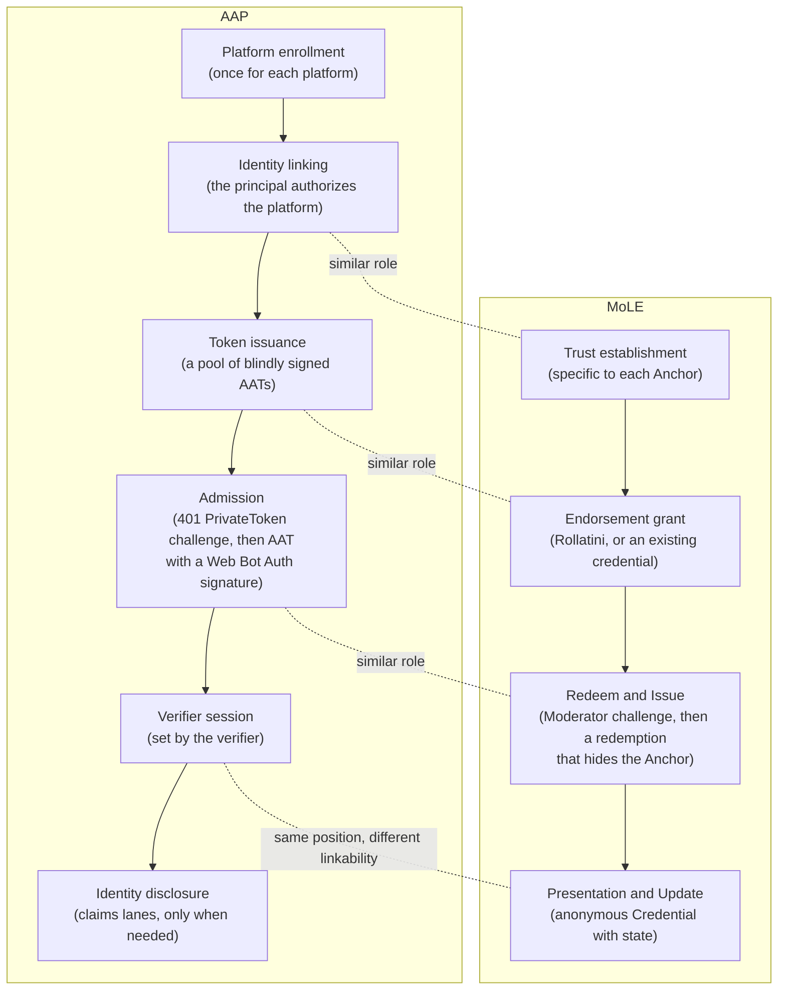

# AAP and MoLE: a comparison

This document compares the Agent Attestation Protocol (AAP) with Moderation of unLinkable Endorsements (MoLE). Both are Internet-Drafts in progress. Both let a service decide whether to admit a client without learning who the client is.

The comparison is informative. It does not change either specification. It describes both drafts at these versions:

- AAP: the [AAP drafts](https://github.com/agentic-protocols/agentic-attestation-protocol/tree/6db384ebc9b26b90d939d54312a88732e02b6c5d) at commit `6db384e` (2026-10-02).
- MoLE: the [MoLE drafts](https://github.com/Moderation-of-unLinkable-Endorsements/internet-drafts/tree/b1449df4d1c8f15570f22edbf40e8dd6980197b9) at commit `b1449df` (2026-10-08).

Both drafts change often. A statement here can become out of date after those commits. Citations give the draft name and the section title, for example (AAP, "What the AAT Asserts") or (MoLE Architecture, "Security Goals and Threat Model").

## Summary

- AAP and MoLE address the same first question: should a service admit this client? Both answer it with tokens from a third party. In AAP and in the MoLE Rollatini Endorsement type, the third party signs the tokens blindly and issues them in limited numbers. The MoLE Longfellow type instead proves in zero knowledge that the client holds an existing credential, such as an mdoc, from one of the accepted issuers. The server accepts each token or redemption once.
- The two drafts use different sources of trust. In AAP, trust comes from the issuer. An identity provider authenticated a principal and authorized an agent to act for that principal. In MoLE, trust starts with an Anchor and then changes over time. A Moderator adjusts the trust it gives a client at each presentation, and it does this without linking the visits of the client.
- AAP ends its token flow at admission. After admission, the verifier uses its own session, which can link the requests in that session. MoLE continues after admission with an anonymous Credential that has state. The Moderator updates that state on each presentation, and the presentations are not linkable to each other.
- An AAP verifier learns which issuer signed a token. A MoLE Moderator learns only that the Endorsement came from one of the Anchors that it accepts. If the Moderator accepts only one Anchor, the redemption names that Anchor.
- AAP includes a module for consented disclosure of facts about the principal. MoLE does not address identity disclosure.
- AAP builds on published Privacy Pass RFCs, JOSE, and SD-JWT. MoLE defines new cryptographic constructions, some of them with post-quantum variants. Some MoLE wire formats are not yet complete, among them the Longfellow circuits and configuration discovery.

## Documents compared

AAP has three documents:

| Document | Content |
|---|---|
| `draft-agent-attestation-protocol` (AAP) | The core: the Agent Attestation Token (AAT) and its format, issuance, presentation with a Web Bot Auth signature, offline verification, and discovery |
| `draft-aap-identity-claims` (AAP Identity Claims) | Two lanes for disclosure of facts about the principal, a consent model, and a disclosure policy |
| `draft-aap-local-agent` (AAP Local Agent) | Profiles for agents whose key lives on the device of the principal, including platform-endorsed keys |

MoLE has seven documents:

| Document | Content |
|---|---|
| `draft-jms-mole-architecture` (MoLE Architecture) | Roles, flows, privacy and security goals, and deployment considerations |
| `draft-jms-mole-protocols` (MoLE Protocols) | Endorsement types, Credential types, common interfaces, and registries |
| `draft-jms-mole-http-transport` (MoLE HTTP Transport) | The `Mole` HTTP authentication scheme and the `Mole-Credential` response header |
| `draft-authors-mole-rollatini` (Rollatini) | An Issuer-Hiding Anonymous Token (IHAT), the cryptography of the Rollatini Endorsement type |
| `draft-authors-mole-act` (ACT) | Anonymous Credit Tokens, the cryptography of the ACT Credential type |
| `draft-authors-mole-vole-ihat` (Moussaka) | A candidate post-quantum IHAT |
| `draft-authors-mole-vole-act` (Ratatouille) | A candidate post-quantum variant of ACT |

## Comparison at a glance

| Topic | AAP | MoLE |
|---|---|---|
| Main question | Does an accountable principal stand behind this agent? When needed, what consented fact about the principal applies? | Does this client have enough trust? An Anchor gives the first trust, and the Moderator changes it at each presentation. |
| Clients | Software agents that act for a human principal. The agent software identifies itself with Web Bot Auth. | Any client, including browsers, delegated agents, and crawlers. A delegated agent can look the same as its user. |
| Source of trust | The identity provider of the principal (the Issuer). The Issuer authenticated the principal and authorized the agent platform. | The criteria of the Anchor (for example, a login, a CAPTCHA, or a payment), then the view of the Moderator over time. |
| Token at admission | AAT: a Privacy Pass token of type `0x0002` (Blind RSA). Any party with the issuer key can verify it. | Endorsement: a Rollatini token, or a Longfellow zero-knowledge proof over an existing mdoc credential. A Moderator can also issue Credentials with no Endorsement. |
| Issuer visible at redemption | Yes. The `token_key_id` identifies the issuer. | No, when the Anchor Set has more than one Anchor. The redemption proves membership in the Anchor Set. |
| State after admission | A session that the verifier sets, for example a cookie. The verifier can link requests in the session. | An anonymous Credential with state: an ACT credit balance, or a Privacy Pass token that the Moderator replaces on each use. Presentations are not linkable. |
| Rate limiting | Issuance limits per principal at the Issuer. | Limits on Endorsements at the Anchor, plus amounts that the Moderator spends and refunds through Credential state. |
| Verifiers | Any party on the request path, offline. An edge and an origin can both verify. | Endorsements are publicly verifiable. A Credential is presented only to the Moderator that issued it. |
| Binding to the request | A Web Bot Auth HTTP message signature covers the `Authorization` header. An optional mode binds tokens to the agent key. | The redemption proof includes a `redemption_context` from the Moderator. An ACT presentation can be bound to one request, or to a policy only. Holder binding for reverse-flow Credentials is an open item. |
| Freshness | A stable challenge allows token pools. The Web Bot Auth signature gives freshness. | Endorsements are obtained in advance. The `redemption_context` names the Moderator and its policy, should name a time window, and can be computed without state. |
| Size on the wire | One Blind RSA token in the `Authorization` header. | An ACT presentation is about 4.5 KB to 8.7 KB in the `Authorization` header, for P-256 and a 32-bit balance. |
| Identity disclosure | Two lanes, a consent model, and a disclosure policy (AAP Identity Claims). | Out of scope. |
| Threat model | Described in the privacy text. The Security Considerations section is not complete. | An explicit adversary model for privacy and for security. |
| Consistency of keys and configuration | Keys come from the issuer origin over HTTPS. Key rotation is additive. | Clients must receive the same configuration. The draft names consistency mechanisms. |
| Discovery | Defined well-known documents for issuers and requesters. | Not yet defined. |
| HTTP | Reuses the `PrivateToken` scheme. AAP Identity Claims adds the `Identity-Presentation` header. | Defines the `Mole` scheme with separate `endorse`, `redeem`, and `challenge` parameters, the `Mole-Credential` header, and a Redeem & Issue endpoint that the client `POST`s to. |
| Extensibility | A new profile uses a new `token_type`. | Registries for Endorsement and Credential types, with reserved values for greasing. |
| Post-quantum | Not discussed. | Discussed for privacy and security. Candidate post-quantum schemes exist. |
| Issuer operations | Blind RSA issuance: one round trip, no issuer state, and batch issuance. | Rollatini issuance: three messages over two HTTP exchanges. The Anchor keeps state for each session. |
| Verification cost | One RSA signature verification. | For Rollatini, computation grows linearly with the size of the Anchor Set, while the proof size grows logarithmically. For ACT, the cost grows linearly with the balance width. |

## Roles

The two drafts use different names for similar roles. The mapping is approximate.

| AAP | MoLE | Notes |
|---|---|---|
| Principal, Agent, and Agent Platform | Client | AAP separates the human who gives consent, the running software that holds the key, and the operator that the Issuer enrolls. MoLE uses one Client role. |
| Issuer | Anchor | Both vouch for a client from an existing relationship and limit issuance. The AAP Issuer and the Rollatini Anchor sign blindly. A Longfellow Anchor issues an ordinary credential, such as an mdoc. |
| Identity linking (an OAuth grant with the `aap:represent` scope) | Trust establishment | AAP defines this step. MoLE leaves it to each Anchor. |
| AAT | Endorsement | Both are accepted once. An AAT and a Rollatini Endorsement are blindly signed. A Longfellow Endorsement is a proof over an existing credential. |
| Verifier (edge or service) | Moderator | An AAP verifier checks tokens. A Moderator also issues and updates Credentials. |
| One `PrivateToken` challenge for each accepted issuer | The Anchor Set in the Moderator challenge | Both tell the client which issuers the server accepts. |
| Verifier session | Credential, with Presentation and Update | Same position in the flow. The AAP session is linkable. The MoLE Credential is not. |
| Public metadata class | Rollatini issuance context (`ctx_iss`) | Both put public data into a partially blind signature. AAP uses it for a coarse assurance class. MoLE uses it for an epoch. |
| `redemption_context` of the `TokenChallenge` | `redemption_context` of the `RedemptionChallenge` | Both scope a redemption. In AAP it is empty, or fixed to the agent key in the key-bound mode. In MoLE the Moderator sets it to name itself, its policy, and a time window. The Rollatini `ctx_red` is a fixed value that is the same for all Moderators. |
| Token key rotation | Epochs, Anchor key rotation, and a new ACT `credential_context` | All of these act as coarse revocation. |
| Verifier removes an issuer from its trust policy | A Moderator removes an Anchor from its Anchor Set | Both stop accepting tokens from one vouching party (AAP, "Verification"). MoLE can also end one Credential at its next presentation. |
| Platform de-listing | (none) | The AAP Issuer stops issuance for every agent of one enrolled platform. MoLE has no platform role. |
| Identity claims module | (none) | |

## Flows

The diagram shows the main flow of each draft, one draft in each column. Dotted lines connect steps that have a similar role.

## Similarities

- **Anonymous admission.** Both drafts avoid long-term identifiers at admission. In both, the token is one input to the decision of the server. It does not entitle the client to access (AAP, "Verification", and MoLE Architecture, "Reduced-Friction Challenges").
- **A third party that vouches.** The AAP Issuer and the MoLE Anchor have the same structural role. Each has an existing relationship with the client and keeps that relationship separate from the party that controls access.
- **Unconditional blindness.** Privacy Pass requires that issuance reveals nothing about the private input of the client, independent of hardness assumptions (RFC 9576, Section 3.5). Blind RSA meets this requirement. Rollatini is statistically blind (Rollatini, "Security Considerations"). In both, a future quantum computer cannot link a redemption to its issuance.
- **Scarcity against abuse.** AAP limits issuance for each principal. MoLE Architecture states that Anchors need to limit the Endorsements that they grant to each user. For Longfellow, scarcity depends on the issuance limits of the existing credential (MoLE Protocols, "Differences from Rollatini").
- **Single use and a replay store.** Both require the server to reject a token that it saw before. In both, the client uses each token only once.
- **A stable token challenge.** Tokens in both drafts can exist before the challenge that they answer. For this reason, AAP and the MoLE reverse-flow Credential type both require a stable Privacy Pass `TokenChallenge` (AAP, "Presentation", and MoLE Protocols, "Privacy Pass with a Reverse Flow"). The MoLE `redemption_context` can also be the same for every client under one policy and time window (MoLE Protocols, "Redemption Challenge Binding").
- **Tokens obtained in advance.** Both drafts recommend that clients get tokens before they need them. Issuance at the moment of redemption can let the timing link the two events.
- **Public data as a privacy cost.** AAP limits public metadata to a small number of values. Rollatini requires a coarse issuance context, and ACT requires coarse credential contexts and amounts that do not vary per client. Both drafts state that each distinct public value divides the anonymity set.
- **The HTTP authentication framework.** Both use a `401` response with `WWW-Authenticate`. Both can send one challenge for each option and let the client choose.
- **No revocation of single tokens.** Neither draft can revoke one outstanding AAT or Endorsement. Both use epochs or key rotation as a coarse control.
- **Agents as a use case.** MoLE Architecture has a use case for user agents that act under delegation. AAP is built for that case.

## Differences

### Meaning of trust

In AAP, accountability is a property of issuance. It does not change after the Issuer signs the token. The Issuer cannot later name the principal behind a redeemed token (AAP, "What the AAT Asserts"). If an admitted agent causes abuse, the verifier can end the session, re-challenge for a fresh AAT, block the agent key or the platform, or stop trusting the issuer. The principal can revoke the linking grant, which stops new issuance (AAP, "Session Establishment").

In MoLE, trust changes over time. At each presentation, the Moderator can spend credits, offer a top-up, and choose the refund. It can end the Credential by declining to refund. The client carries the result, and the Moderator still cannot link the visits of the client (MoLE Architecture, "User Agents Acting Under Delegation", and MoLE Protocols, "Anonymous Credit Tokens (ACT)"). The amounts must not vary per client under a policy and should come from a small set of values (MoLE Protocols, "Privacy Considerations"). The adjustment is therefore a policy decision applied at presentation, not a setting for one client.

### Visibility of the issuer

AAP names the issuer at redemption. The draft treats the named issuer as the basis of accountability. Because the verifier knows the issuer, the verifier can measure abuse for each issuer directly.

MoLE hides the Anchor within the Anchor Set. MoLE Architecture states that a visible Anchor can reveal attributes of the client and can allow different treatment by Anchor. A redemption against an Anchor Set of one Anchor names that Anchor, but it stays unlinkable to the grant (Rollatini, "Security Considerations"). The draft has a placeholder for a feedback mechanism that measures abuse for each Anchor. That mechanism is not yet specified.

### State after admission

In AAP, the AAT starts a session but is not a session. After admission, the service can treat the agent as it treats a signed-in user. The verifier can link all requests in that session (AAP, "Session Establishment").

In MoLE, the client stays anonymous after admission. Each presentation of a Credential is not linkable to earlier presentations or to issuance (MoLE Architecture, "Privacy Goals and Threat Model"). An ACT Credential supports one presentation at a time: the client waits for the refund before the next presentation, and must store each presentation durably before it sends it (MoLE Protocols, "Client State"). A lost response can be recovered with a recovery handle (MoLE Protocols, "Lost Refunds").

### Verifiers

AAP requires a token type that any party can verify with the public key of the issuer. It does not allow the privately verifiable Privacy Pass type for this use, because the verifier and the issuer are different parties. An edge and an origin can verify the same token.

In MoLE, ACT Credentials use a secret key of the Moderator and are not publicly verifiable (ACT, "The Credential Scheme"). The client presents a Credential only to the Moderator that issued it. All servers that accept the same ACT key and credential context must share one atomic nullifier store (MoLE Protocols, "Security Considerations").

### Binding of the token to the request

AAP binds a token to a request with a separate layer: a Web Bot Auth signature over the `Authorization` header. In the default mode, the token is a bearer token. The AAT is valid at every verifier that accepts its issuer, and each verifier keeps its own replay store.

MoLE binds each redemption proof to the `redemption_context` of the Moderator challenge. The value must name the Moderator and its policy, and should name a time window. A Moderator that accepts only the values it constructs rejects a redemption made for another Moderator. This does not stop a Moderator that relays the challenge of another Moderator to the client (MoLE Protocols, "Redemption Challenge Binding"). An ACT presentation can be bound to one request, session, or time window. With an empty `request_context`, it is a one-use bearer authorization for a policy (MoLE Protocols, "Challenge Binding").

### Visibility of the agent

AAP identifies the agent software with Web Bot Auth and hides only the principal. MoLE lets a delegated agent look the same as its user. It gives the user agent the job of hiding differences in request content, timing, or rate. MoLE also describes a separate pool of Anchors for agents, so that servers can tell agents apart when that is the goal.

### Identity disclosure

AAP Identity Claims defines how a service asks for a fact about the principal, how the principal gives consent, and how the fact arrives bound to the service. MoLE does not define identity disclosure. In MoLE, the Longfellow Endorsement type uses an existing mdoc credential only as proof that a trusted issuer signed it. The redemption reveals no attributes.

### Threat model

MoLE Architecture lists privacy properties and the capabilities of the adversary. For privacy, the adversary can act in any role, can collude with other parties, can deviate from the protocol, and can have a quantum computer in the future. For security, the adversary can control many clients and some Anchors. It cannot break the criteria of trusted Anchors and does not have a quantum computer.

AAP describes privacy properties and remaining exposures in prose. It does not define an adversary model. Its Security Considerations section is a list of topics to cover.

MoLE requires that clients receive the same configuration, including the same Anchor Set in the same order. It names mechanisms that give that consistency. AAP requires same-origin HTTPS for keys and forbids token keys that distinguish agent platforms. AAP does not specify a mechanism that lets an agent confirm that other clients receive the same token key.

### Cryptography

AAP uses published and deployed primitives: Blind RSA, JOSE, and SD-JWT. It does not discuss post-quantum security.

MoLE uses new constructions: Rollatini, ACT, and Longfellow. These constructions are not yet complete standards, and the ACT security proofs are not yet written. The post-quantum variants (Moussaka and Ratatouille) state that they are not yet suitable for real-world use, because they lack significant security analysis. Their public keys are approximately 45.5 KB. A forgery against Ratatouille-MQ was found and fixed in October 2026.

### HTTP carriage and extensibility

AAP reuses the `PrivateToken` scheme of RFC 9577, so existing Privacy Pass software can carry an AAT. MoLE defines a new `Mole` scheme. MoLE also defines behavior that AAP does not:

- A `200` response can include a `Mole` challenge, to tell the client that a presentation can give higher limits or less friction.
- A `403` response means that policy forbids the request. For ACT, a failed proof or a repeated nullifier is a `401`.
- A client that lost the response to a presentation can send a recovery request. The Moderator answers with `409` and the recorded update, and does not perform the operation again.
- The Moderator sends the credential update even when the protected operation fails.
- Clients send reserved random type values ("greasing"), so that servers continue to accept unknown types.

## Design trade-offs

Each design choice below gives a benefit and has a cost. The table does not rank the two drafts.

| Design choice | Used by | Benefit | Cost |
|---|---|---|---|
| Issuer visible at redemption | AAP | The verifier decides trust for each issuer and can measure abuse for each issuer with no added mechanism. | The issuer identity divides the anonymity set. A verifier can treat clients differently by issuer. |
| Issuer hidden in an Anchor Set | MoLE | The Anchor does not divide the anonymity set and is not a basis for different treatment. | Abuse measurement for each Anchor needs a separate mechanism. Proof computation grows with the Anchor Set. The hiding depends on the Moderator accepting more than one Anchor. |
| Public verification by any party on the path | AAP | An edge and an origin can both verify offline with one signature check. | A token is valid at every verifier that accepts the issuer. Replay is limited to one use at each verifier and by issuance limits. |
| Redemption proof bound to a Moderator challenge | MoLE | Tokens obtained in advance, scoped to one Moderator, policy, and time window. | New cryptography and a higher verification cost. A Moderator that relays another Moderator's challenge is not stopped. |
| Verifier session after admission | AAP | Uses the session mechanisms that services already have. | The verifier can link requests in the session. If the verifier keeps no session, the agent spends one token on each request. |
| Anonymous Credential with state | MoLE | Rate limits and trust that change over time, with no linking of presentations. The Moderator can end a Credential. | A Credential works only at the Moderator that issued it. One ACT Credential supports one presentation at a time, so parallel requests need several Credentials. The client trusts the Moderator to refund honest presentations. The Moderator must set spend and refund amounts for each policy, decide the refund at each presentation, and send an update even when the protected operation fails. An ACT presentation adds several kilobytes to each request. |
| Stateless issuance | AAP | One round trip, batch issuance, and no session state at the issuer. | No issuer hiding and no post-quantum path in the current design. |
| Stateful partially blind issuance | MoLE | An epoch bound into each Endorsement, and a basis for issuer hiding. | Three messages over two exchanges. If an Anchor answers two challenges with the same session state, the Anchor signing key can be recovered. |
| Identified agent software | AAP | Services can identify agent traffic and route or treat it separately. | Agent traffic is visible as agent traffic. |
| Agent traffic that can look like user traffic | MoLE | Agent traffic is not singled out. | Services cannot tell agents apart unless a separate Anchor pool is used. |
| Identity disclosure in scope | AAP | One protocol family covers admission and consented facts about the principal. | More specification. On the issuer-mediated lane, the issuer sees each disclosure by design. |
| Explicit threat model and consistency requirements | MoLE | Privacy properties hold against colluding and deviating parties when the requirements are met. | Deployments must operate a consistency mechanism and must meet anonymity-set thresholds. |

## Shared open problems

- **Late binding.** The AAP key-bound mode fixes the agent key at issuance. In Rollatini, the redemption context `ctx_red` is fixed at issuance. In both, a token bound to one context needs a separate issuance for each other context. Moussaka notes that late binding and tokens that the client can show more than once could be added (Moussaka, "Overview").
- **Reuse across verifiers.** The AAP replay store is local to each verifier. The Rollatini nullifier is the same at every Moderator, but MoLE Protocols states that the scheme does not enforce single use across Moderators. MoLE also requires that a client not redeem one Endorsement at a second Moderator. Both drafts rely on limits at issuance to bound this reuse.
- **Revocation.** Neither draft can revoke one outstanding AAT or Endorsement. After Redeem and Issue, MoLE can end the Credential of a client at its next presentation by declining to refund. After admission, AAP can end the verifier session or re-challenge, and can block the agent key or platform. Both rely on key rotation or epochs as the coarse control.
- **Anonymity-set size.** Both depend on the number of clients that share the same issuer, key, epoch, and metadata. Neither draft gives the client a way to confirm that number.
- **Denial of service.** MoLE notes that a server spends work on redemptions and presentations that fail, and suggests rate limits before verification (MoLE Protocols, "Security Considerations"). AAP orders its checks so that key lookup occurs before signature work, but it does not discuss denial of service.
- **Forgery by a quantum computer.** A quantum computer can forge tokens of both current designs, because both depend on RSA or discrete logarithms.

## Sources

- AAP: `draft-agent-attestation-protocol.md`, `draft-aap-identity-claims.md`, and `draft-aap-local-agent.md` at commit `6db384e`.
- MoLE: `draft-jms-mole-architecture.md`, `draft-jms-mole-protocols.md`, `draft-jms-mole-http-transport.md`, `draft-authors-mole-rollatini.md`, `draft-authors-mole-act.md`, `draft-authors-mole-vole-ihat.md`, and `draft-authors-mole-vole-act.md` at commit `b1449df`.
- RFC 9576, The Privacy Pass Architecture, Sections 3.3, 3.4, 3.5, and 6.2.

This comparison does not review the Privacy Pass reverse-flow draft (`draft-meunier-privacypass-reverse-flow`) or Longfellow (`draft-google-cfrg-libzk`) directly. Statements about those drafts come from the MoLE descriptions of them.
