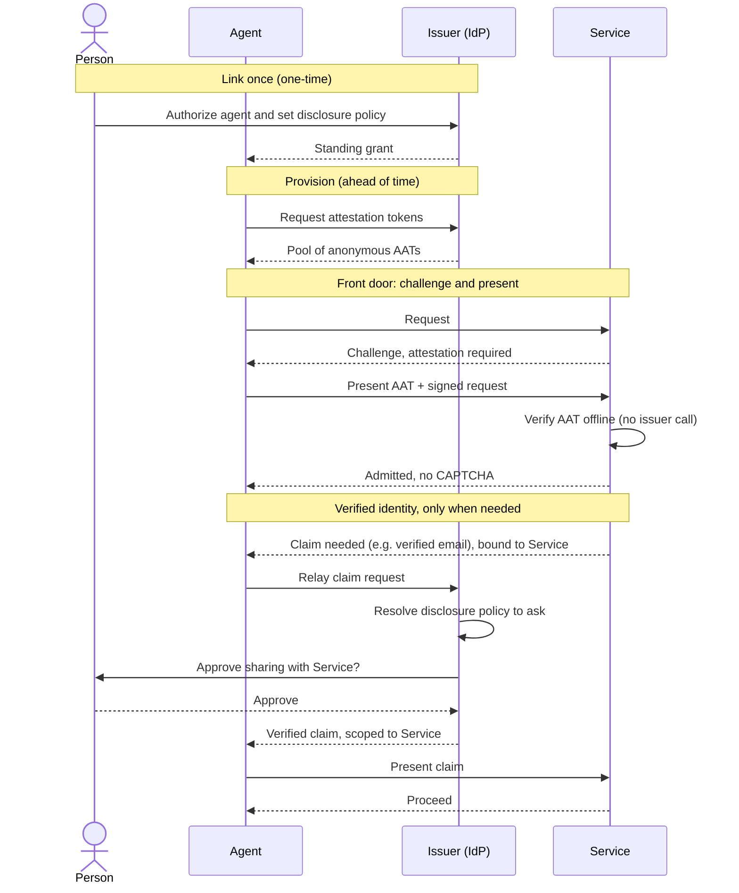

# Agent Attestation Protocol 2-pager

## The problem

AI agents are becoming more popular, but the web's security layer cannot tell them apart from the rest of automated traffic. CAPTCHAs, WAFs, edge blocks, and bot detection see an agent acting for a specific person no differently from an autonomous crawler, a scraper, or a bot farm. The distinction that matters is absent: nothing tells a service whether an accountable person authorized this agent and stands behind it. This is not about sorting good bots from bad. It is that a service cannot identify the category it can most safely admit, an agent acting on behalf of an attested person. Absent that signal, a service blocks broadly, and agents that a real person authorized get stopped before they can accomplish their task.

Today's workarounds make this worse. A person hands their password to the agent, bakes long-lived credentials into it, or babysits every step and gives up the autonomy that made the agent useful. None of these are safe, and none of them give the service anything it can actually trust.

The missing primitive is trust. What a service actually needs to know is that an accountable person (or company) stands behind the agent, but an agent has no portable, verifiable way to prove that to a service it has no prior relationship with. Existing tools assume that relationship: OAuth needs the agent pre-registered, and a CAPTCHA only asks "are you human," never "did someone authorize you."

And once an agent is past the door, the service still does not know who it is acting for. When it needs a specific fact about that person (a verified email to match an account, an age to clear a gate), there is no consented way to get it short of the person filling in a form.

## How we solve it

The Agent Attestation Protocol is an open standard that gives an agent two things.

**An anonymous attestation at the front door.** The agent presents a short-lived token, the Agent Attestation Token (AAT), to the service, in which a trusted identity provider vouches for the accountable person behind the agent: the provider has a standing relationship with that person and stands behind the agent acting on their behalf. The token names no one and carries no personal data. Any party on the request path (a CDN, a bot-detection service, or the service itself) verifies it offline against the provider's published keys. That vouch is what the door actually needs, and it is enough to let a legitimate agent through without a CAPTCHA.

**Verified identity on demand, with consent.** When an interaction genuinely needs a fact about the person, the service asks for it. The person's provider releases it, bound to that service and under the person's consent, either live or from a wallet the agent provisioned ahead of time. The service receives a verified claim (an "over 21", a confirmed email) instead of a self-asserted form field.

The front door is anonymous; identity is requested, consented, and scoped to the service that needs it. The protocol composes deployed standards: Privacy Pass for the anonymous token, Web Bot Auth and HTTP Message Signatures for the request signature, and SD-JWT-VC and OpenID Connect for identity claims.

**What it unlocks, from basic to advanced:**

1. **Get through the front door.** A person's agent is researching or shopping and gets blocked by bot defenses. It presents an attestation, the WAF or service confirms an accountable person is behind it, and the agent is let through with no CAPTCHA.
2. **Clear an age or eligibility gate.** A person asks their agent to buy wine. The service needs proof the buyer is over 21. The provider releases an "over 21" result bound to that service and under consent, so the service clears the gate without building its own age check.
3. **Create a new account with no forms.** A person tells their agent to sign up for a service that requires a verified email and name. The provider releases just those, and the service provisions the account with no signup form and no confirmation link.
4. **Recognize and route, don't block.** A service that wants to welcome good agents uses the agent's signed request to recognize them and route them to a better path, such as a clean API or an MCP endpoint, instead of serving a human web page or blocking outright.
5. **Feed a trust signal into risk.** Even when a service admits an agent, it can pass the attestation into its existing fraud and risk model as a positive signal and lower friction for known-good agents rather than treating all automated traffic alike.

## How it works

- **Person (principal):** authorizes an agent to act for them and consents to any identity disclosure.
- **Agent:** the software acting on the person's behalf, such as a coding agent, an online chat agent, an assistant, or a CLI.
- **Issuer (identity provider):** the person's provider. Has a standing relationship with them, vouches for the agent acting on their behalf, issues the anonymous attestation, and signs identity claims under the person's policy.
- **Service:** the destination, such as a merchant or an API. Decides its own trust policy and what it requires.

1. **Link once.** The person authorizes an agent at an identity provider they already use, either an agent platform they use or, for an agent they run themselves, the agent directly. This establishes a standing grant and captures the person's *disclosure policy*: their standing preferences for which facts may later be shared, with which services, and whether each is released automatically, only after a per-use approval, or never. The policy is set once here so later disclosures can be resolved against it without returning to the person every time.
2. **Provision.** The agent obtains a pool of anonymous attestation tokens ahead of time, so it can present one at the door with no round-trip.
3. **Admit.** On first contact, the agent presents an attestation token alongside a signed request. Any party on the path verifies it offline and admits the agent.
4. **Disclose only when needed.** If the interaction needs a fact, the service asks for it, the person's provider releases just that claim bound to that service under consent, and the agent relays it.

## The protocol at a glance

The protocol is a layered model. Each layer answers one question and composes with the others through a single agent key:

| Layer                                    | Question it answers                          | Mechanism                              |
| :--------------------------------------- | :------------------------------------------- | :------------------------------------- |
| Software identity                        | Which agent is calling?                      | Web Bot Auth / HTTP Message Signatures |
| Front-door attestation                   | Is an accountable person behind this agent?  | Anonymous attestation token (AAT)      |
| Identity disclosure                      | Who is the person, and what about them?      | Consented, audience-bound claims       |
| Account authentication and authorization | Is this a known account, and what may it do? | Delegated to OAuth and OpenID Connect  |
| Delegated authority                      | What may the agent do?                       | Deferred to a later revision           |

Properties that matter to adopters:

- **Anonymous and unlinkable by construction.** The front-door token carries no identity and cannot be correlated back to the person or across services, so privacy is a property of the format, not a promise the provider is trusted to keep.
- **Accountable.** Behind the anonymity is a named provider that has a standing relationship with the person, vouches for the agent acting for them, and answers for the agents it admits.
- **Verifiable by anyone, offline.** No prior registration and no per-request callback to the provider.
- **Composes with the stack.** It sits beneath checkout and payment protocols and alongside bot-verification work, rather than replacing any of them. The clearest example is UCP, the Universal Commerce Protocol. UCP standardizes the commerce operations between an agent and a business once the agent is already inside and trusted: discovering a catalog, building a cart, checking out, placing an order. This protocol operates upstream of all of that. It answers "should I let this agent in, and who is behind it?" before any cart or checkout begins, where UCP answers "how does an admitted agent transact?" The two are complementary layers on the same request, and a service can adopt either without the other.

## Why an open protocol

Most of the current work in this space takes one of two shapes. Some of it is a registry: a list, curated by one party, that agents or operators must enroll in to be recognized. Some of it is a paid service that sits in the middle of every request as the broker of trust.

We believe an open protocol is the way to win. A registry is only as broad as its owner's reach, and it makes that owner the gatekeeper of who counts as legitimate. A paid broker puts a toll and a single point of dependence on traffic that has to flow across the entire web, and no large platform wants its agents' access to ride on a competitor's list or invoice. An open protocol has neither problem: any party can issue tokens, any party can verify them offline against published keys, and a person can carry them anywhere, without registering with a gatekeeper or paying a per-request toll. Trust stays the verifier's own decision rather than a central authority's. That is the shape that reaches the scale of the open web, and it is how the internet's durable trust primitives won, from TLS and the public certificate authorities to OAuth: open standards that anyone could adopt on their own terms.

## Example use cases

**SaaS Product Research.** Maya is comparing project-management tools for her team and turns her agent loose to read a dozen vendors' pricing and docs pages. A dozen rapid page loads from one client looks exactly like scraping, and today the agent is met with CAPTCHAs and edge blocks halfway through, returning with half the answer. Here, each site verifies the attestation, sees that an accountable person stands behind the traffic, and lets the agent read freely. Nothing about Maya is disclosed, because nothing needs to be. The door only needed to know a real person was behind the request, not who. The agent comes back with a complete comparison instead of a partial one.

**Meal kit sign-up.** Maya's agent signs her up for a new meal-kit service. Normally this means a signup form, an email confirmation link, and an SMS code. Three separate places an agent stalls and silently fails, leaving Maya to wonder later why nothing happened. Here the agent is admitted on its attestation, and the service asks for a verified email and a verified phone. Maya's identity provider releases exactly those, already verified, so the service skips the confirmation link and the one-time code entirely. The account is live before she looks up from her laptop, and the two steps most likely to break a headless task never had to happen.

**Haircut appointment.** Priya's agent books a haircut at a salon whose site is a CAPTCHA-walled booking widget, the kind of small task that is somehow harder than it should be. The agent is admitted on its attestation, and the salon needs only two things to hold the slot: a verified name and a verified phone, so they can text if the stylist runs late. Priya's identity provider releases just those, scoped to the salon and nothing more. The appointment is booked, and her contact details are not sprayed across a third-party platform on the way. A vivid reminder of how little actually needs to move to finish a task.

**Delivery eligibility.** Priya's agent is lining up a same-day grocery service for a dinner party that evening. Before it builds a cart, the service needs to know it actually delivers to her: the "enter your ZIP to check availability" step that so often dead-ends a flow at the very end. The agent is admitted, and Priya's provider releases her verified address, scoped to that service, so coverage is confirmed and the delivery window locked in up front. The agent fills the cart knowing the order will land, rather than assembling everything only to be turned away at checkout.

**Warranty return.** Wei's premium headphones die three months in. He asks his agent to file the warranty claim and arrange a replacement, the chore everyone postpones for weeks. Warranty portals usually demand he locate the original order, log into an account he forgot he made, and prove the purchase. Instead, the agent is admitted, and the manufacturer asks only for a verified email to match the order already on file; Wei's provider releases just that, scoped to the manufacturer.

The claim is filed and a replacement shipped and because the manufacturer can also feed the attestation into its existing fraud and risk model as a positive signal, it lowers friction for a claim it knows an accountable person stands behind, rather than treating it like one more anonymous request.

**Mortgage shopping.** Sam is buying his first home and wants pre-approval rates from six lenders, without six lenders, and the data brokers behind them, knowing he is shopping. Six agents hitting six lender portals in parallel looks exactly like fraud, and every portal wants identity verification before it will quote. With the protocol, each lender verifies the attestation and admits the agent, then independently asks for the facts it needs, each disclosure bound to that lender alone. Because the front-door token is anonymous and unlinkable by construction, no lender, and no broker downstream, can correlate that the same person is shopping all six. Sam gets his rates; the market never learns his hand.

**Buying a database mid-build.** Nadia's coding agent is building a service on her laptop and reaches the point where it needs a hosted database on a paid plan. Normally the build stalls here: the agent lands on the provider's signup page, trips the bot check, and even if it gets through, it still has to create an account, confirm an email, and paste a long-lived API key into the project, the kind of credential that ends up committed by accident. Here the agent, running on Nadia's machine, is admitted on its attestation, and when the provider sets up the account it asks only for a verified email, which Nadia's provider releases scoped to that provider. The paid plan is purchased and the database's connection string handed back through the provider's normal flow, issued fresh to this project rather than a static key sitting in the agent. Nadia comes back to a working database instead of a half-finished setup and a list of manual steps.
